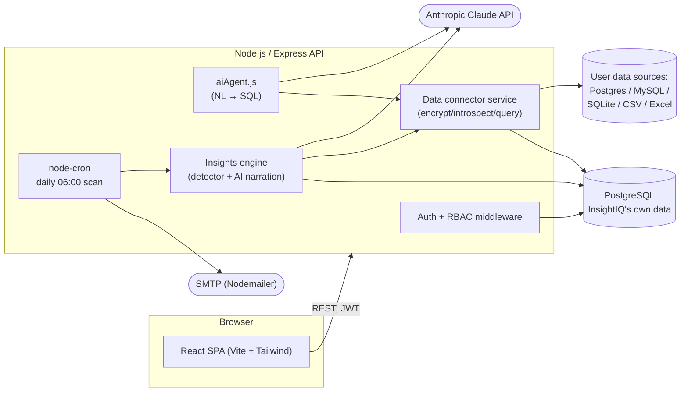

# InsightIQ

**Intelligence that moves with you**


InsightIQ is an AI-powered Business Intelligence agent. It connects to your
databases and spreadsheets, lets you ask questions about your data in plain
English, turns the answers into shareable dashboards, and proactively flags
trends and anomalies it finds along the way — all through a single web app.

Built as a full-stack reference implementation: JWT auth with enforced RBAC,
encrypted-at-rest database credentials, a natural-language-to-SQL engine on
Claude's structured outputs (not brittle text parsing), a drag-and-drop
dashboard builder with PNG/PDF export, and a scheduled insights/anomaly job
with email digests.

## Table of contents

- [Status](#status--all-7-phases-complete)
- [Key features](#key-features)
- [Architecture](#architecture)
- [Tech stack](#tech-stack)
- [Data model](#data-model)
- [API reference](#api-reference)
- [Project structure](#project-structure)
- [Getting started (local development)](#getting-started-local-development)
- [Environment variables](#environment-variables)
- [Roles & permissions](#roles--permissions)
- [Security notes](#security-notes)
- [Running with Docker](#running-with-docker)
- [Deployment](#deployment)
- [Known limitations & roadmap](#known-limitations--roadmap)
- [Design language](#design-language)
- [Author](#author)

## Status — all 7 phases complete

- [x] **Phase 1** — Project setup
- [x] **Phase 2** — Authentication & user management (JWT, RBAC)
- [x] **Phase 3** — Database connector module (Postgres/MySQL/SQLite/CSV/Excel)
- [x] **Phase 4** — AI natural-language-to-SQL engine (Claude)
- [x] **Phase 5** — Interactive dashboard builder (charts, drag-and-drop, export)
- [x] **Phase 6** — Insights & anomaly detection (scheduled scan, email digest)
- [x] **Phase 7** — Admin panel, responsive polish, Docker, deploy config

## Key features

### Authentication & access control
JWT-based signup/login (bearer header or httpOnly cookie), bcrypt password
hashing, and three roles — `ADMIN`, `ANALYST`, `VIEWER` — enforced on every
protected route on the **server**, not just hidden in the UI. A disabled
(`isActive: false`) account is rejected at the auth-middleware layer even with
a still-valid token.

### Database connectors
Connect a live **PostgreSQL** or **MySQL** database, or upload a **CSV**,
**Excel**, or **SQLite** file. Uploaded files are parsed, type-inferred per
column, and materialized into a local SQLite file per data source — so they
can be queried with real SQL exactly like a live database, through the same
code path. Connection credentials are encrypted at rest with AES-256-GCM
before they ever reach the database.

### Ask AI — natural language to SQL
Type a question in plain English; Claude is given the target schema and asked
to return `{ sql, explanation }` via the Messages API's **structured
outputs** (a JSON-schema-constrained response), not free-text parsing. The
app then executes the query and returns results as a table alongside the
generated SQL and a plain-English explanation. Every query — AI-generated or
otherwise — is passed through a read-only guard before execution (see
[Security notes](#security-notes)).

### Dashboards
Save any query result as a chart widget. Chart type (**Bar / Line / Pie /
Area / Table**) is auto-suggested from the shape of the result set, or picked
manually. Widgets live on a drag-and-drop, resizable grid
(`react-grid-layout`); layout changes are persisted automatically. Export an
entire dashboard as a **PNG** or **PDF** snapshot.

### Insights & anomaly detection
A daily scheduled job (`node-cron`, 06:00) scans every active user's data
sources for statistically significant findings — period-over-period swings
and z-score outliers — then hands the raw numbers to Claude to write up as a
plain-English insight with a severity (`INFO` / `WARNING` / `CRITICAL`). New
insights surface on the home dashboard and, if SMTP is configured, go out as
an email digest. Insights can also be triggered on demand per data source.

### Admin panel
Platform-wide usage stats, a user table with inline role and active-status
management (an admin cannot demote or deactivate themselves through this
screen — that's enforced server-side), and a read-only view of every
connected data source across all users.

## Architecture



## Tech stack

| Layer    | Choice                                                                        |
| -------- | ------------------------------------------------------------------------------ |
| Frontend | React 19 (Vite), Tailwind CSS v4, React Router, React Query, Recharts, react-grid-layout, html2canvas-pro, jsPDF |
| Backend  | Node.js, Express 5, Prisma ORM, PostgreSQL                                    |
| AI       | Anthropic Claude API (`claude-opus-4-8` by default) — NL→SQL and insight narration, via structured outputs |
| Auth     | JWT (httpOnly cookie + bearer header support), bcrypt password hashing        |
| Data     | `pg`, `mysql2`, `node:sqlite`, `exceljs`, `csv-parse` — one connector service, five source types |
| Jobs     | `node-cron` (daily insight scan), Nodemailer (digest email)                    |
| DevOps   | Docker (multi-stage builds), Docker Compose, Render Blueprint                 |

## Data model

Defined once in `server/prisma/schema.prisma` and evolved through additive
migrations rather than schema churn. Core models:

| Model | Purpose |
| --- | --- |
| `User` | Account + role (`ADMIN`/`ANALYST`/`VIEWER`) + active flag |
| `DataSource` | A connected database or uploaded file; encrypted `connectionInfo`, cached schema, owner |
| `SavedQuery` | A persisted record of an Ask-AI question, its generated SQL, and a result preview |
| `Dashboard` | A named collection of widgets with a persisted grid layout |
| `Widget` | One chart/table on a dashboard — type, config (source query), grid position |
| `Insight` | An AI-narrated finding (trend/anomaly) with a severity, tied to a data source |
| `Report` / `ReportShare` | Modeled for saved/shared report exports (see [Known limitations](#known-limitations--roadmap) — not yet wired to an API) |
| `AuditLog` | Generic action log keyed to a user |

## API reference

All routes are prefixed with `/api`. Except `/health` and `/auth/register|login|logout`,
every route requires a valid JWT (`Authorization: Bearer <token>` or the
`token` httpOnly cookie set on login). "Owner-scoped" means the query is
implicitly filtered to resources the caller created; the Admin routes are the
only cross-user views.

<details>
<summary><strong>Auth</strong> — <code>/api/auth</code></summary>

| Method | Path | Auth | Description |
| --- | --- | --- | --- |
| POST | `/register` | Public | Create an account (defaults to `VIEWER`) |
| POST | `/login` | Public | Authenticate, receive a JWT |
| POST | `/logout` | Public | Clear the auth cookie |
| GET | `/me` | Any role | Current authenticated user |

</details>

<details>
<summary><strong>Data sources</strong> — <code>/api/data-sources</code></summary>

| Method | Path | Auth | Description |
| --- | --- | --- | --- |
| GET | `/` | Any role | List the caller's data sources |
| GET | `/:id` | Any role (owner) | Get one data source + cached schema |
| GET | `/:id/preview` | Any role (owner) | Sample rows from a table |
| POST | `/connect` | `ADMIN`, `ANALYST` | Connect a live Postgres/MySQL database |
| POST | `/upload` | `ADMIN`, `ANALYST` | Upload a CSV / Excel / SQLite file |
| POST | `/:id/test` | `ADMIN`, `ANALYST` | Re-test a live connection |
| DELETE | `/:id` | `ADMIN`, `ANALYST` | Remove a data source |

</details>

<details>
<summary><strong>Ask AI</strong> — <code>/api/query</code></summary>

| Method | Path | Auth | Description |
| --- | --- | --- | --- |
| POST | `/ask` | Any role | `{ dataSourceId, question }` → generated SQL + results. Rate-limited to 30 requests / 15 min per client. |

</details>

<details>
<summary><strong>Dashboards</strong> — <code>/api/dashboards</code></summary>

| Method | Path | Auth | Description |
| --- | --- | --- | --- |
| GET | `/` | Any role | List the caller's dashboards |
| POST | `/` | Any role | Create a dashboard |
| GET | `/:id` | Any role (owner) | Dashboard + widgets |
| PATCH | `/:id` | Any role (owner) | Rename/update a dashboard |
| DELETE | `/:id` | Any role (owner) | Delete a dashboard |
| POST | `/:id/widgets` | Any role (owner) | Add a chart/table widget |
| PATCH | `/:id/widgets/:widgetId` | Any role (owner) | Update a widget |
| DELETE | `/:id/widgets/:widgetId` | Any role (owner) | Remove a widget |
| GET | `/:id/widgets/:widgetId/data` | Any role (owner) | Execute the widget's query live |
| PATCH | `/:id/layout` | Any role (owner) | Bulk-save grid positions (drag-and-drop) |

</details>

<details>
<summary><strong>Insights</strong> — <code>/api/insights</code></summary>

| Method | Path | Auth | Description |
| --- | --- | --- | --- |
| GET | `/` | Any role | List the caller's insights |
| POST | `/scan-all` | `ADMIN`, `ANALYST` | Scan all of the caller's data sources now. Rate-limited to 20 / 15 min. |
| POST | `/scan/:dataSourceId` | `ADMIN`, `ANALYST` | Scan one data source now |
| DELETE | `/:id` | Any role (owner) | Dismiss an insight |

</details>

<details>
<summary><strong>Admin</strong> — <code>/api/admin</code> (ADMIN only)</summary>

| Method | Path | Description |
| --- | --- | --- |
| GET | `/stats` | Platform-wide totals, users-by-role, data-sources-by-type |
| GET | `/users` | List every user |
| PATCH | `/users/:id` | Change a user's role or active status |
| DELETE | `/users/:id` | Delete a user (and cascade their data) |
| GET | `/data-sources` | List every data source across all users |

</details>

<details>
<summary><strong>Health</strong></summary>

| Method | Path | Description |
| --- | --- | --- |
| GET | `/api/health` | `{ status, database }` — used by Docker/Render health checks |

</details>

## Project structure

```
insightiq/
├── client/                       # React frontend (Vite)
│   └── src/
│       ├── components/
│       │   ├── admin/            # Admin panel tables/stat cards
│       │   ├── dashboard/        # ChartWidget, widget cards, modals
│       │   ├── dataSources/      # Connect/upload modals, source cards
│       │   ├── layout/           # Navbar (incl. mobile menu)
│       │   └── ui/               # Button, Input, Modal, ErrorBoundary...
│       ├── pages/
│       ├── hooks/
│       ├── context/
│       └── utils/                # api client, chart color palette, chart-type suggestion
├── server/                       # Node/Express backend
│   ├── controllers/
│   ├── routes/
│   ├── middleware/                # auth, upload, validation, error handling
│   ├── prisma/                    # schema + migrations
│   ├── services/
│   │   ├── aiAgent.js             # NL → SQL (Claude, structured outputs)
│   │   ├── insightsEngine.js      # statistical detection + AI narration
│   │   ├── insightDetector.js     # pure stats: z-score / period-over-period
│   │   ├── insightsAgent.js       # Claude narration for detected findings
│   │   ├── dataSource.service.js  # connect/introspect/run query (+ read-only guard)
│   │   ├── fileImport.service.js  # CSV/Excel/SQLite → materialized SQLite
│   │   └── emailService.js        # Nodemailer digest
│   ├── jobs/insightsScan.job.js   # daily cron (06:00) across all users
│   ├── config/                    # env, prisma client, shared Anthropic client
│   └── Dockerfile
├── client/Dockerfile
├── docker-compose.yml             # Postgres + server + client, wired together
├── render.yaml                    # Render Blueprint (see Deployment below)
└── README.md
```

## Getting started (local development)

### Prerequisites

- Node.js 20+
- A running PostgreSQL instance — local install, or `docker compose up -d postgres`

### 1. Backend

```bash
cd server
cp .env.example .env      # fill in JWT_SECRET, ENCRYPTION_KEY (see below), etc.
npm install
npx prisma migrate dev --name init
npm run dev                # http://localhost:5000
```

`GET /api/health` should return `{ "status": "ok", "database": "connected" }`.

### 2. Frontend

```bash
cd client
cp .env.example .env
npm install
npm run dev                # http://localhost:5173 (or next free port)
```

## Environment variables

Full list in `server/.env.example` and `client/.env.example`. The ones that
need a real value before the app will boot or fully work:

| Variable | Required for | Notes |
| --- | --- | --- |
| `DATABASE_URL` | Server to boot at all | Postgres connection string |
| `JWT_SECRET` | Server to boot at all | Any long random string |
| `ENCRYPTION_KEY` | Server to boot at all | **Exactly 64 hex chars.** Generate: `node -e "console.log(require('crypto').randomBytes(32).toString('hex'))"` |
| `ANTHROPIC_API_KEY` | Ask AI, insight narration | Without it, those features return a clear "not configured" error instead of crashing; everything else still works |
| `ANTHROPIC_MODEL` | Ask AI, insight narration | Defaults to `claude-opus-4-8` |
| `SMTP_HOST` / `SMTP_USER` / `SMTP_PASSWORD` | Daily email digest | Without it, the insight scan still runs and saves insights — it just skips sending mail (logged, not fatal) |
| `UPLOAD_DIR` / `MAX_UPLOAD_SIZE_MB` | File uploads | Default `./uploads`, 25 MB |
| `VITE_API_URL` (client) | Frontend to reach the API | Defaults to `http://localhost:5000/api` |

## Roles & permissions

| Capability | ADMIN | ANALYST | VIEWER |
| --- | :---: | :---: | :---: |
| Browse/preview own data sources & dashboards | ✅ | ✅ | ✅ |
| Ask AI questions | ✅ | ✅ | ✅ |
| Build/edit dashboards, save queries | ✅ | ✅ | ✅ |
| Connect/upload/delete data sources | ✅ | ✅ | ❌ |
| Trigger an insight scan | ✅ | ✅ | ❌ |
| Admin panel (users, roles, platform stats, all data sources) | ✅ | ❌ | ❌ |

Data sources, dashboards, saved queries, and insights are scoped to the user
who created them — the Admin panel's data-source list is the only built-in
cross-user view.

## Security notes

- **Credentials at rest**: live-database passwords are encrypted with
  AES-256-GCM (`server/utils/crypto.js`) before being stored; the key never
  leaves the server process.
- **Read-only SQL guard**: every query — whether typed by a user or generated
  by Claude — is checked against a guard that rejects anything except a
  single `SELECT`/`WITH` statement before it's executed
  (`dataSource.service.js`). This is defense-in-depth on top of the AI's own
  system-prompt instructions.
- **Server-enforced RBAC**: role checks live in Express middleware
  (`requireRole`), not just conditional UI rendering — hitting a
  role-restricted endpoint directly with a `VIEWER` token returns `403`.
- **Rate limiting**: auth, Ask AI, and insight-scan endpoints are separately
  rate-limited (`express-rate-limit`) since they're the most abuse- and
  cost-sensitive surfaces.
- **Secrets never committed**: `.env` files are git-ignored on both client and
  server; the Render Blueprint marks equivalent values `sync: false` so they
  must be set directly in the hosting dashboard.

## Running with Docker

```bash
cp server/.env.example server/.env   # fill in the required values above
docker compose up -d --build
```

This starts Postgres, the API (`http://localhost:5000`), and the frontend
(`http://localhost:5173`, served via nginx) wired together on one network.
Uploaded files persist in a named volume across restarts.

> **Note:** the Dockerfiles follow standard multi-stage Node/Alpine + nginx
> patterns but haven't been build-tested in this environment (no Docker
> daemon available here) — worth a first `docker compose up --build` check
> before relying on it.

## Deployment

**Render** — `render.yaml` in the repo root is a ready-to-use
[Blueprint](https://render.com/docs/blueprint-spec): push to GitHub, then in
the Render dashboard choose **New → Blueprint** and point it at the repo. It
provisions a managed Postgres, the API, and the static frontend. After the
first deploy, set the secrets marked `sync: false` in the dashboard
(`ENCRYPTION_KEY`, `ANTHROPIC_API_KEY`, SMTP credentials) — they're
intentionally not committed to the repo.

**Railway** — no committed config needed: create two services from this
repo (one rooted at `/server`, one at `/client`), Railway auto-detects each
`Dockerfile`; add a Postgres plugin and copy its connection string into
`DATABASE_URL`; set the same env vars as above on the server service, and
`VITE_API_URL` as a build arg on the client service pointing at the server's
public URL.

## Known limitations & roadmap

Documented deliberately rather than glossed over:

- **Report sharing is modeled but not wired up.** `Report` and `ReportShare`
  exist in the Prisma schema for "save and share a report with teammates",
  but there's no controller/route/UI for them yet — `SavedQuery` rows are
  persisted on every Ask-AI call, but there's no history list endpoint to
  browse them either.
- **MySQL connector is implemented but untested against a live server** — the
  Postgres, SQLite, CSV, and Excel paths were all exercised against real
  databases/files during development; MySQL never had a live instance
  available to verify against.
- **Docker build is unverified** — see the note under
  [Running with Docker](#running-with-docker).
- **Single-region, single-instance assumptions** — no queueing/backoff beyond
  the Anthropic SDK's own retries; the daily insight scan runs in-process on
  whichever instance is up at 06:00, which is fine for one instance and would
  need a leader-election or external scheduler for a multi-instance deploy.

## Design language

- **Colors**: Deep navy `#03122A`, Electric blue `#378ADD`, Accent green `#97C459`
- **Font**: Inter
- **Style**: Dark-mode first, clean and minimal
- **Charts**: a validated, CVD-safe categorical palette built from the brand
  colors (see `client/src/utils/chartColors.js`) — chart series use a
  slightly deepened step of the accent green, since the full-brightness UI
  green is too light to read well as a data mark on the navy surface.

## Author

- **Jesse Odoh**

Built with the assistance of [Claude Code](https://claude.com/claude-code) and the Anthropic API.
